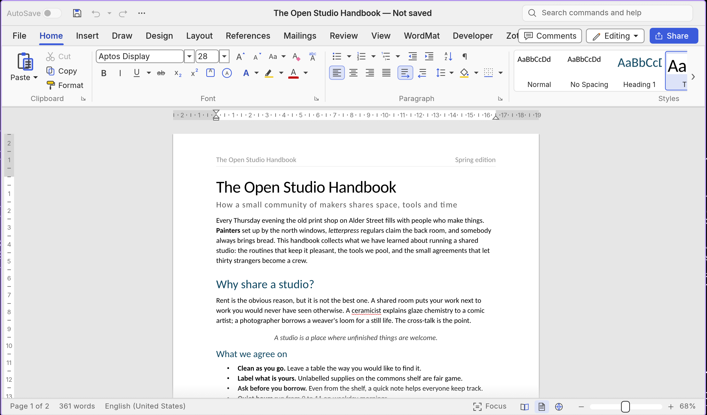
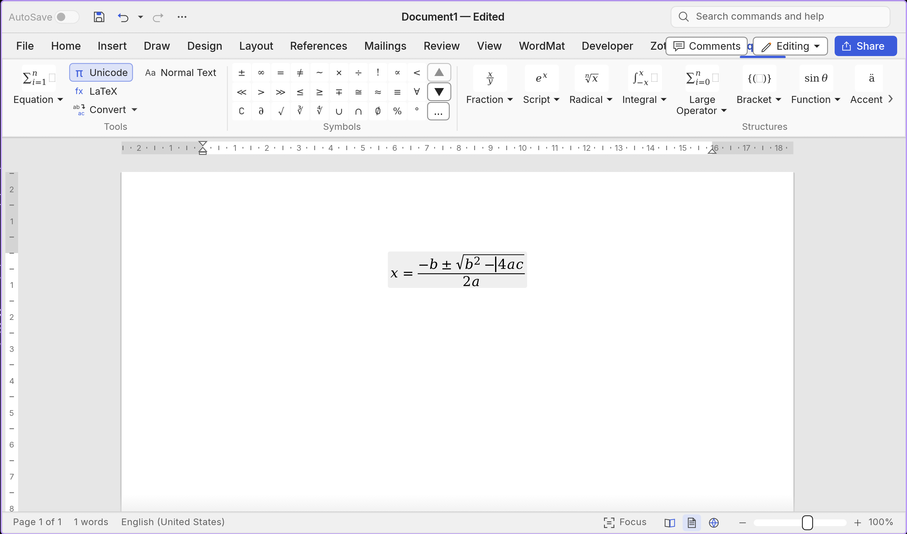

# Quill

Free word processing with Danish mathematics built in.

Quill is a Word-compatible writing app (.docx in and out, and PDFs open as editable documents)
with a **WordMat tab** for mathematics: calculate, solve equations, units, matrices, plots — with
answers in green right inside the equation. It runs on macOS, Windows and Linux, and in the
browser.





## What makes Quill different

- **Mathematics in the document, not next to it.** The WordMat tab calculates, solves, converts
  units, works with matrices and draws graphs — and the answer appears in green inside the same
  equation. It is the Danish school tool WordMat, as a tab, with the same engine (Maxima).
- **Your writing stays where you keep it.** Open a Nextcloud server in the Navigation pane and
  browse, open, save, share and search the server's own files; open an Obsidian vault and your
  notes keep their frontmatter, wikilinks and embeds.
- **Free and open source** (MIT OR Apache-2.0), and built to be driven: every action is a
  command, so scripts and AI agents can use Quill over MCP or a JSON control channel.
- **Yours to keep.** No account, no cloud service, no telemetry.

## Install

Quill is built from source and packaged for every platform. The packages are published on the
[releases page](../../releases); to build one yourself, see
[`docs/releasing.md`](docs/releasing.md).

| Platform | Package | Needs |
|---|---|---|
| macOS | `quill-<version>-macos-<arch>.dmg` (universal) | — |
| Windows | `quill-<version>-windows-<arch>.msi` (x64, x86, arm64) or a portable `.zip` | — |
| Linux | `quill-<version>-linux-<arch>.AppImage`, `.deb`, `.rpm`, `.flatpak`, `.tar.gz` | — |
| Browser | `quill-web-<version>.zip` (a static site) | — |

**The maths tab needs [Maxima](https://maxima.sourceforge.net/), the calculation engine WordMat
uses.** It is not bundled:

- Arch/CachyOS: `sudo pacman -S maxima`
- Debian/Ubuntu: `sudo apt install maxima`
- Fedora: `sudo dnf install maxima`
- macOS: `brew install maxima`

Quill looks for Maxima on `PATH` and, on macOS, also in Homebrew's and MacPorts' prefixes: an app
started from Finder never has those on its `PATH`. Without Maxima the tab says so — and how to
install it — and the rest of Quill works as usual.

Optional, for better real-domain solving: put `solvereal.mac` in
`~/.local/share/mathcraft/packages/` and point `MATHCRAFT_SOLVEREAL` at it. SolveReal is GPL and
never ships with Quill — you fetch it yourself.

## The WordMat tab

| Key | Does |
|---|---|
| Alt+M | New equation |
| Alt+B | Calculate the selection |
| Alt+L | Isolate a variable |

Select e.g. `x^2-4=0` → **Isolate** gives `x = -2 or x = 2` in green. Select `x^2, -5, 5` →
**Plot graph**. All workflows are in [`docs/wordmat-fane.md`](docs/wordmat-fane.md).

## Where your writing lives

| | |
|---|---|
| **Nextcloud** | Connect to a server, browse its folders, open and save files on it, share them, and search the server's own files. The editor never waits for the server, and a file that changed there in the meantime is not overwritten. See [`docs/cloud.md`](docs/cloud.md). |
| **Obsidian** | Open a vault, search its notes, and see which notes link to the open one and which tags the notes carry. Notes keep their frontmatter, wikilinks and embeds, and an untouched note saves back byte for byte. See [`docs/obsidian.md`](docs/obsidian.md). |

## What works, and what does not

Honest, and measured: the full table is in [`docs/file-format-parity.md`](docs/file-format-parity.md)
and [`docs/status.md`](docs/status.md).

| | |
|---|---|
| **Writing and formatting** | Text, styles, lists, tables, headers and footers, footnotes, comments, tracked changes, content controls, fields, equations, pictures, text boxes, page setup, a table of contents, cross-references, citations (Zotero). The Word feature catalog is at **497 of 504** ([`docs/parity-checklist.md`](docs/parity-checklist.md)). |
| **.docx** | Opens and saves Word's format. 71 real documents — the Word, Outlook and LibreOffice files in Apache POI's test data, pinned by SHA-256 — read → write → read with their text, tables, headers and footers, notes, comments and pictures intact, and 62 of the 65 whose page count Word recorded paginate to the same number of pages. Fetch the corpus with `cargo xtask corpus --docx`; the check skips without it ([`docs/docx-corpus.md`](docs/docx-corpus.md)). |
| **Other formats** | `.doc` (read), `.rtf`, `.odt`, `.md`, `.html`, `.txt`, `.tex` — read and write; PDF export; PDFs open as editable documents (PDF Reflow). |
| **Not yet** | Charts and SmartArt from Word are shown but not editable; embedded OLE objects show as their picture; 3-D models, legacy form fields and East Asian text layout are dropped; `.doc` cannot be written; macros are kept but never run; the interface is in 20 languages, Danish among them, and the maths tab's messages are Danish too (the native-speaker review of the Danish strings is still open). |

## For developers

```sh
cargo xtask ci            # format, clippy, tests, assets, layering, package names, wasm
cargo xtask corpus --docx # fetch the real-world .docx corpus
cargo xtask stats         # tests and lines per crate
```

Everything is a command: the ribbon, the keyboard shortcuts, the command search, the CLI, the
control channel and the MCP server all dispatch by the same id. See [`AGENTS.md`](AGENTS.md) for
the working rules and [`docs/architecture.md`](docs/architecture.md) for the layers.

Quill is a snapshot fork of WordCraft (MIT OR Apache-2.0): upstream history is deliberately not
tracked here, so an upstream change arrives as a hand port. [`FORK.md`](FORK.md) says which parts
of the app are Quill's own (the WordMat tab, Nextcloud, the Obsidian vaults, the Danish work and
the branding), every upstream file Quill modifies and what changed in it, and the rules a port
follows. Plain Markdown, so a port can be reviewed file by file.

## License

Free and open source (MIT OR Apache-2.0 — see `LICENSE-MIT`, `LICENSE-APACHE`).
Builds on WordCraft by the ArtCraft team and contributors (see `ATTRIBUTION.md`).
Original mathematics code in `crates/engine/src/cmd/mathcraft.rs`,
`mathgraf.rs`, `crates/doc/src/math_edit.rs`.
