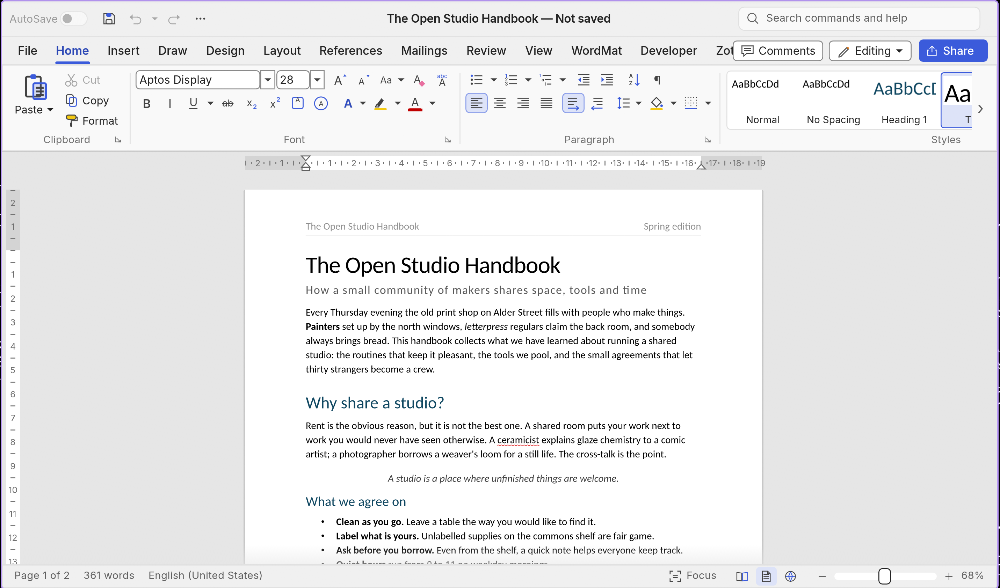
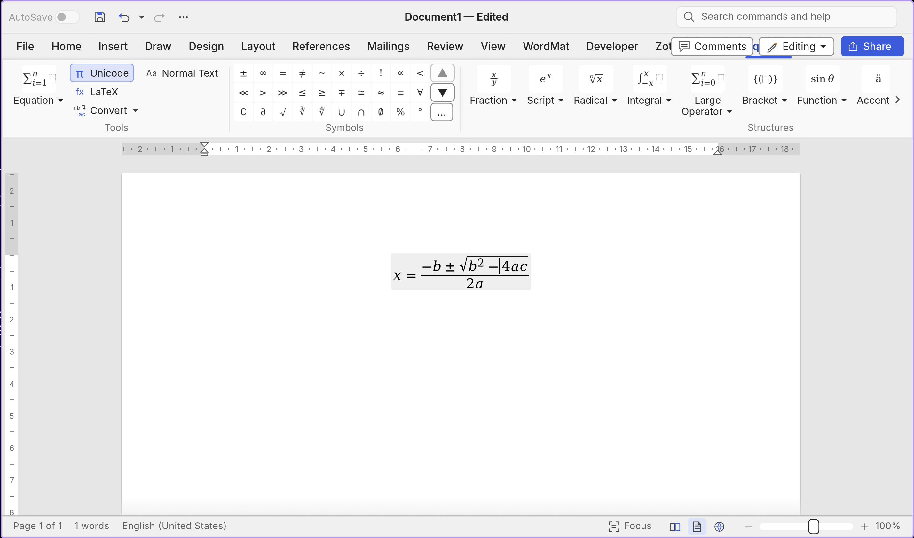

# Quill

Free word processing with Danish mathematics built in.

Quill is a Word-compatible writing app (.docx in and out, and PDFs open as
editable documents) with a **WordMat tab** for
mathematics: calculate, solve equations, units, matrices, plots — with answers in green
right inside the equation.

## Install (Linux)

1. Download `quill-1.0.0-linux-x86_64.AppImage` from [Releases](../../releases).
2. Install the Maxima calculation engine (not bundled):
   - Arch/CachyOS: `sudo pacman -S maxima`
   - Debian/Ubuntu: `sudo apt install maxima`
   - Fedora: `sudo dnf install maxima`
3. Run the AppImage. The WordMat tab creates itself on first launch.

Optional (better real-domain solving): place `solvereal.mac` in
`~/.local/share/mathcraft/packages/` and point `MATHCRAFT_SOLVEREAL` at it.
SolveReal is GPL and never ships with Quill — you fetch it yourself.

## The WordMat tab

| Key | Does |
|---|---|
| Alt+M | New equation |
| Alt+B | Calculate the selection |
| Alt+L | Isolate a variable |

Select e.g. `x^2-4=0` → **Isolate** gives `x = -2 or x = 2` in green.
Select `x^2, -5, 5` → **Plot graph**. All workflows are in
[`docs/wordmat-fane.md`](docs/wordmat-fane.md).

## Where your writing lives

| | |
|---|---|
| **Nextcloud** | Connect to a server, browse its folders, open and save files on it, share them, and search the server's own files. The editor never waits for the server, and a file that changed there in the meantime is not overwritten. See [`docs/cloud.md`](docs/cloud.md). |
| **Obsidian** | Open a vault, search its notes, and see which notes link to the open one and which tags the notes carry. Notes keep their frontmatter, wikilinks and embeds, and an untouched note saves back byte for byte. See [`docs/obsidian.md`](docs/obsidian.md). |

## License

Free and open source (MIT OR Apache-2.0 — see `LICENSE-MIT`, `LICENSE-APACHE`).
Builds on WordCraft by the ArtCraft team and contributors (see `ATTRIBUTION.md`).
Original mathematics code in `crates/engine/src/cmd/mathcraft.rs`,
`mathgraf.rs`, `crates/doc/src/math_edit.rs`.

## Development

The work list for the next release is
[`docs/release-plan-1.2.md`](docs/release-plan-1.2.md) — shared with the agents that
build Quill. The Word-parity backlog is [`docs/gaps.md`](docs/gaps.md), and what is
Quill's own code is listed in [`FORK.md`](FORK.md).
